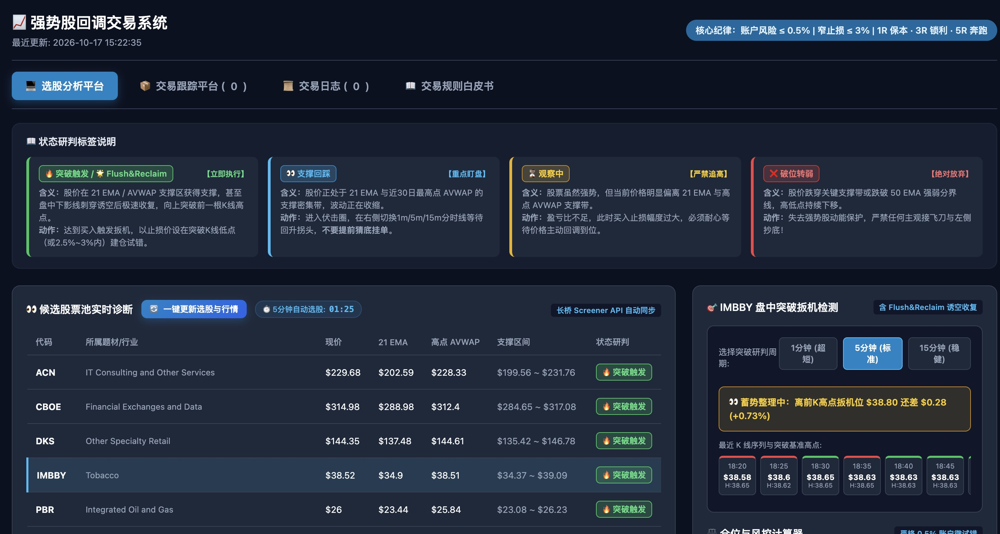
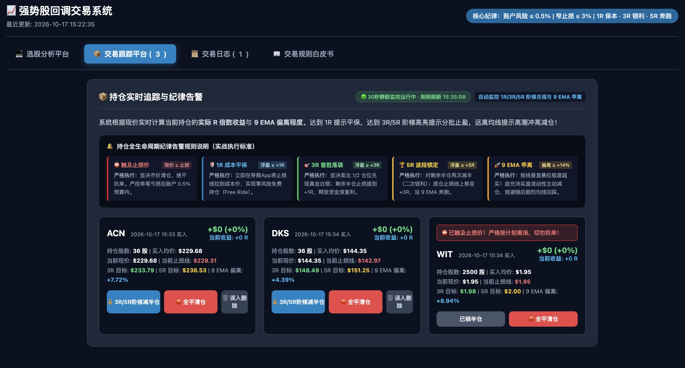

# 强势股回调交易系统 (Strong Stock Pullback Momentum System)

> 基于 2025 年全美投资大赛 (USIC) 冠军 **Martin Luk**（年化收益率 **+969.8%**）核心交易哲学与实战体系构建的自动化量化分析与交易跟踪平台。

---

## 🌟 核心理念与战法精髓

本系统旨在解决散户交易美股时的两大痛点：**“追高容易站岗”** 与 **“浮盈容易回吐变亏损”**。系统完整复刻并量化了 Martin Luk 的交易闭环：

1. **核心底色**：专做**最强主线中的强势龙头股**，绝不在底部摸奖。
2. **拒绝盲目追高**：摒弃突破即追的追涨杀跌，专注捕捉**日线收敛（VCP）**后回踩关键支撑区域的**二次企稳突破点**。
3. **Flush & Reclaim（诱空收复）**：主力常在盘中假跌破 9 EMA 或关键支撑诱杀跟风止损盘，若分时迅速强势拉回收复支撑，即形成**金标不对称买点**。
4. **0.5% 账户微试错原则**：无论多看好某只标的，单笔最大亏损必须严格锁死在总账户净值的 **0.5%** 之内；止损空间严控在 **≤ 3%**。
5. **阶梯兑现与防利润回吐**：
   - **+1R 浮盈** ➡️ 立即将止损线上移至成本价（平保），彻底消除本金风险。
   - **+3R 目标** ➡️ 坚决市价减半仓锁定利润，释放流动性滚动复利。
   - **+5R 目标** ➡️ 趋势波段大赢家二次减仓，保护核心战果。
   - **9 EMA 跟踪** ➡️ 剩余仓位沿日线 9 EMA 追踪主升浪；短线极度暴拉偏离 9 EMA > 14% 时主动冲高兑现。

---

## 🖥️ 系统功能架构（四大平台）

系统采用轻量化、高响应的微服务与单页面架构，分为四大独立协同的 Tab 模块：

```
┌─────────────────────────────────────────────────────────────┐
│                 强势股回调交易系统 (Port 1098)                 │
├──────────────┬──────────────┬──────────────┬────────────────┤
│ 💻 选股分析平台 │ 📦 交易跟踪平台 │ 📜 历史交易  │ 📖 交易规则白皮书 │
└──────────────┴──────────────┴──────────────┴────────────────┘
```

### 1. 💻 选股分析平台


- **长桥 Screener API 全美股自动初筛**：自动筛选全美股市值 > $2B、成交额 > $20M、股价 > $10 的动量领头标的。
- **候选股票池实时诊断**：多线程计算 9/21/50 EMA、Swing AVWAP 锚定成交量加权均线与量价异动，自动生成四种实战状态研判标签（`🟢 Flush&Reclaim金标买点`、`🔵 9EMA回踩企稳区`、`🟡 VCP收敛观察中`、`🔴 跌破支撑放弃`）。
- **联动分时突破图**：点击任意一行股票，毫秒级调用长桥分时接口渲染 **1分钟 / 5分钟 / 15分钟** K线图与分时突破线。
- **仓位与风控计算器**：输入账户总规模与单笔风险上限（0.5%），自动计算建议买入股数、严格止损线与 1R/3R/5R 目标价位，并可**一键记入在手持仓**。
- **期望值防御沙盘**：基于凯利公式与非对称盈亏比模拟 100 笔交易蒙特卡洛期望值，直观印证“胜率仅 35% 即可实现暴利”。

### 2. 📦 交易跟踪平台


- **持仓实时追踪**：直观展示在手持仓的代码、入场均价、当前止损线、现价、浮盈金额及当前实际捕获的 **R 倍数**。
- **全生命周期纪律告警**：
  - `⛔ 触及止损价` ➡️ 红色警报闪烁，严格执行止损。
  - `🛡️ 1R 成本平保` ➡️ 提示立即在券商 App 移动止损线至开仓成本价。
  - `🎯 3R 目标达成` ➡️ 高亮提醒执行半仓兑现。
  - `🏆 5R 趋势波段` ➡️ 提示二次止盈与上移保盈线。
  - `🚀 9 EMA 极度偏离` ➡️ 偏离 ≥ 14% 预警狂热拉升，建议主动减仓。
- **动态音效预警**：触发 3R/5R 止盈或止损时，系统通过 Web Audio API 自动播放提示音，杜绝盯盘漏单。

### 3. 📜 历史交易
- **战绩归档**：记录每笔平仓的买入价、卖出价、出场时间、实际盈亏金额、最终捕获 R 倍数与离场动作（3R减半仓 / 全平清仓等）。
- **二次确认删除**：单条平仓记录支持带防误触两道确认的删除功能，方便测试期维护数据整洁。

### 4. 📖 交易规则白皮书
- 完整沉淀 2025 USIC 冠军战法的 4 大实战步骤、仓位测算公式、回踩确认判定标准、以及海外一手复盘认知精髓。

---

## ⚡ 核心机制与特色设计

### 1. 选股误入容错机制 (Misentry Fault-Tolerance)
- **误入撤销**：从选股平台误点了买入但实际并未在券商成交的股票，卡片提供 **`🗑️ 误入删除`** 按钮，带有两道防误触二次确认，确认后直接移除，不写入历史战绩。
- **风控硬锁死**：一旦某只股票触发过 **`💰 3R/5R阶梯减半仓`**（已有真实资金成交），界面上的误入删除按钮会**永久隐藏移除**；后端接口 `/api/trades/delete_active` 设置严密校验，直接阻断并返回 `HTTP 400`，绝不允许篡改已有真实交易。

### 2. 双频自动化同步架构 (Dual-Frequency Sync)
为兼顾**分时卖出极高时效性**与**长桥 OpenAPI 30秒限流保护**，系统采用双频分层轮询机制：

- **持仓监控（30 秒静默自动同步）**：
  - 仅对在手持仓（通常 1~5 只）使用长桥 `longbridge quote` **单次批量接口**获取现价，单次耗时 < 0.1 秒，消耗配额仅 5%，永不触发 429 限流。
  - 9 EMA 均线支持智能懒加载与缓存，杜绝重复计算历史数据。
- **选股大池（5 分钟定时自动更新 + 随时一键手动更新）**：
  - 页面提供动态 5 分钟倒计时（`05:00 ➡️ 00:00`），归零时后台自动执行全美股初筛与日线指标重算。
  - 随时支持点击 **【🔄 一键更新选股与行情】** 立即刷新（点击后倒计时自动复位）。

---

## 🚀 快速启动指南

### 环境依赖
- macOS (测试于 macOS Sequoia / Apple Silicon & Intel)
- Python 3.9+
- 已安装并登录配置长桥 CLI / OpenAPI (`longbridge auth login`)

### 一键启动
本项目已配置 macOS 专属启动脚本，直接在 Finder 中双击：
```bash
./启动看板服务.command
```
脚本将自动释放 1098 端口、启动高并发本地行情服务并在默认浏览器打开看板。

### 手动终端启动
```bash
# 1. 生成最新看板数据
python3 generate_web_dashboard.py

# 2. 启动本地后台服务 (端口 1098)
python3 dashboard_server.py
```
在浏览器中访问：`http://127.0.0.1:1098` 即可开始使用。

---

## 📁 目录文件清单

| 文件 | 说明 |
| :--- | :--- |
| `martin_strategy.py` | 量化指标计算引擎（9/21/50 EMA、Swing AVWAP、量价异动、VCP 收敛识别） |
| `generate_web_dashboard.py` | 长桥 Screener API 全美股筛选与交互式 HTML 看板生成器 |
| `dashboard_server.py` | 本地多线程高并发 HTTP API 服务器（处理分时行情、持仓流转、双频同步与平仓归档） |
| `martin_dashboard.html` | 现代化四合一单页面应用（选股、跟踪、日志、白皮书） |
| `trades_data.json` | 交易持仓与历史平仓记录本地持久化存储 |
| `启动看板服务.command` | macOS 一键清理端口、启动服务、唤起浏览器的可执行脚本 |
| `DEVELOPMENT.md` | 系统完整开发全景文档、架构演进与接口协议说明 |

---

## ⚖️ 免责声明
本项目仅供量化交易策略研究与个人复盘学习使用，不构成任何投资建议。股市有风险，入市需谨慎！
